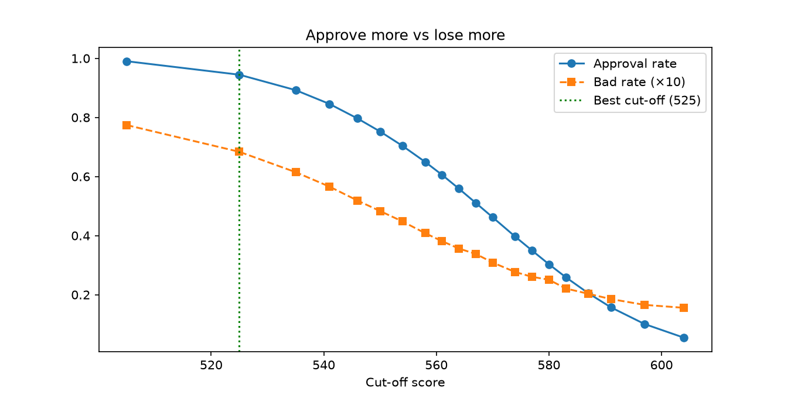

# Credit Analytics: Approvals, Expected Loss and Portfolio Performance

Credit analytics across the loan lifecycle on 307,511 real loan applications and 3.8M monthly card records: who to approve, where losses come from, and where late customers stop recovering.

**Live dashboard:** [credit-risk-a-lmd.streamlit.app](https://credit-risk-a-lmd.streamlit.app/)

## Key findings

- **Default model:** logistic regression on 14 explainable features. Hold-out **AUC 0.735, Gini 0.47, KS 0.35**. Well calibrated: predicted PD is within half a point of the actual bad rate in every risk tier, from 2.0% (tier A) to 19.6% (tier E).
- **Cut-off:** expected profit peaks at **525 points**, approving 94.5% of applicants and cutting the bad rate from 8.07% to 6.84%. This matches the break-even PD of margin ÷ (margin + LGD) = 20%. The best cut-off depends heavily on pricing: at a 5% margin it tightens to 561 points (61% approved).
- **Expected loss:** the riskiest fifth (tier E) is **18% of lending but 44% of expected loss**. Tiers D and E together are 37% of the book and 67% of the loss.
- **Affordability:** the bad rate rises only gently with repayment-to-income (7.2% → 9.0%) and dips above 30%, likely selection bias, since the most stretched applicants were already declined.
- **Vintages:** 2015Q4 was the weakest card cohort at about 1.0% ever 30+ days past due by 24 months; 2016 vintages ran at around half that.
- **Roll rates:** cure rates fall from **62%** at 1–30 days past due to 40%, 33% and **6%** at 90+, while 24% of 61–90 balances roll to 90+. Collections effort pays most at 31–90 days.

## Data

[Home Credit Default Risk](https://www.kaggle.com/competitions/home-credit-default-risk/data) (Kaggle):

- `application_train.csv`: 307,511 applications; `TARGET = 1` = payment difficulties, treated as default
- `credit_card_balance.csv`: 3.8M monthly records for 104,307 card accounts

Raw files aren't in this repo (size and Kaggle rules). Download them into `data/raw/` to rerun the notebooks.

**Assumptions:** LGD 60%, margin 15% on good loans, EAD = loan amount. Card dates are relative, so vintage labels are illustrative. Accounts already open when the data starts are excluded (left-censoring).

## Method

| Notebook | What it does |
| --- | --- |
| [01 Cut-off and expected loss](notebooks/01_cutoff_and_expected_loss.ipynb) | Cleaning, PD model, scorecard points (600 = 50:1 odds, 20 points to double), risk tiers, cut-off table, expected loss (PD × LGD × EAD), affordability |
| [02 Vintage and roll rates](notebooks/02_vintage_and_roll_rates.ipynb) | Monthly panel, vintage curves (fixed denominator, no survivorship bias), roll-rate matrix, annualised loss |

Shared functions live in [`src/credit_analytics.py`](src/credit_analytics.py), used by both notebooks and the dashboard.

## Limitations

- `TARGET` measures payment difficulty, not a full write-off, and is broader than the 90+ days definition used for cards.
- LGD and margin are assumptions; real values would come from recovery and pricing data.
- Card delinquency rates include inactive cards, which lowers them.
- The model sees only approved loans (no reject inference).

**Tools:** Python, pandas, scikit-learn, matplotlib, Plotly, Streamlit

### Connect:

OLAMIDE AKANNI | Data Sci.

---
Feedback welcome!

